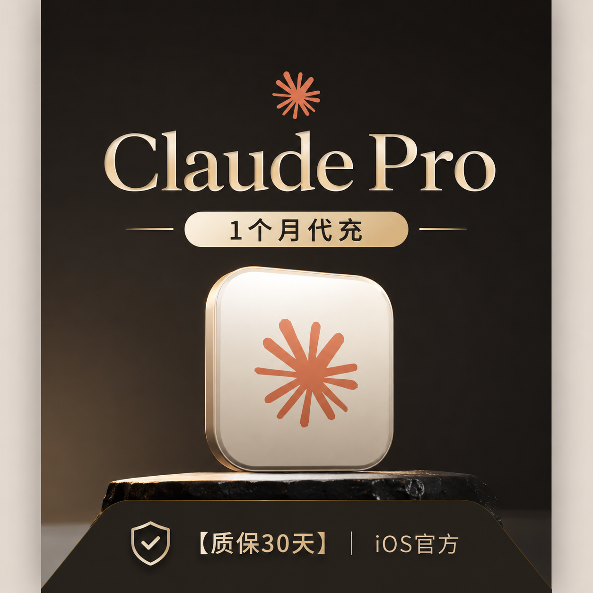

> 在线阅读（GitHub Pages）：https://maynor996.github.io/claude-pro-china-guide/

# 国内怎么用上 Claude Pro：环境、账号与自助开通教程

Claude 写代码、改长文、跑 Agent 都顺手，但在国内想稳定用上 **Claude Pro**，坑通常不在「会不会用」，而在：**网络环境、账号是否干净、订阅怎么开**。

这篇文章按教程写：先讲国内使用要注意什么，再讲开通前自检，最后给一条**自助卡密开通**路径（免交账号密码）。下单页在文末。

## 一、国内用 Claude，先把环境摆对

Anthropic 对地区和环境比较敏感。很多人不是「充值假」，而是**环境分过低**触发风控，表现为掉订阅甚至封号。社区里比较常见的习惯（只能降风险，不能保证）：

| 项目 | 建议 |
|---|---|
| 网络 | 稳定节点，少跨区乱跳；尽量全局代理，避免真 IP 暴露 |
| 时区 | 别用「上海」；不少人用新加坡时区（钟点接近），系统语言尽量英文；时区与节点地区一致 |
| 客户端 | **未开节点不要打开** Claude 网页/客户端 |
| 邮箱 | 优先 Google 等常见海外邮箱 |
| 定位 | 注意系统定位权限是否泄露真实位置 |

一句话：**注册时、登录时、充值时，环境尽量一致。** 用就接受风险；怕封就先别上 Pro。

---

## 二、官网能登录 ≠ 一定能顺利开通订阅

开 Pro 之前，建议自己做一遍自检。下面几类情况，**充了也经常到不了账**，且一般无法按「没到账」退款——所以教程里把红线写在前面。

### 1. 新号先养，别当天冲

更稳妥的做法是账号先正常使用一段时间（常见说法是**至少养号约 3 天**）。刚注册就上 Pro，失败率更高。

### 2. 已有订阅未到期，先别叠

打开账单（Billing）：如果还有**未到期订阅**（无论之前是 iOS、安卓还是信用卡），先等到期、账单里看不到有效订阅，再考虑新开通。

典型翻车：安卓订阅还在期，再买卡密，结果充不进去。

### 3. 账单有欠费或退款记录

Billing 里若有**欠费**、**退款**，新付的钱可能被拿去抵扣，看起来像「钱没了、会员没到」。先把账单理干净。

### 4. 组织 ID「隐性封禁」

有的号能登录，但组织其实已被封。下单前自己测两步：

1. 网页登录后，在对话框随便发一条。若失败且提示组织 ID 相关封禁 → **先别开订阅**。  
2. 进升级 Pro / Max 页面；若右上角出现组织异常/封禁类提示 → **同样别开**。

### 5. 开通后可能遇到 KYC

部分账号开通后会随机要求身份验证（KYC）。这是官方侧机制，需完成后订阅才正常显示。KYC 需自行处理，结果自负。

---

## 三、国内常见开通方式怎么选

| 方式 | 优点 | 注意 |
|---|---|---|
| 官方信用卡 / 海外支付 | 正规 | 卡片、地址、风控要求高，很多人过不去 |
| 找人代登代充 | 省事 | 要交账号密码，隐私与安全风险大 |
| **自助卡密** | 免密、到账快、按网页教程自己点 | 只适合「账号已自检通过」的情况；封号通常不在质保里 |

如果你已经能正常登录、自检没问题，只是缺一张能过的支付方式，**自助卡密**往往更合适：不用把账号密码给别人。

---

## 四、自助开通 Claude Pro（约 1 分钟）

流程很短：

1. 打开下单页下单，系统**自动发卡密**和充值地址/教程  
2. 打开充值页，按说明用卡密完成激活（登录的是你自己的账号）  
3. 回到 Claude 查看订阅；若弹出 KYC，先完成验证再确认是否生效  

说明：

- 支持在现有会员**到期前续费**，但新时长常常是**覆盖**原到期时间，不是简单叠加，自己算好再拍。  
- **质保范围**：一般只质保订阅渠道本身（例如渠道问题导致的掉订阅类问题）。**秒封、环境风控封号不质保、不退款、无售后**——介意的不要用这条路径。  
- 封号多与环境有关；再正规的渠道也保不了「一定不封」。

下单页（自助卡密）：

https://chongzhi.chatgpt-plus.top/claude.html

---

## 五、开通之后怎么用更稳

1. **固定环境**：同一套节点 + 时区 + 浏览器/客户端，别今天家宽明天机场 Wi‑Fi 硬上。  
2. **先当生产力工具用**：正常对话、写代码、改文档，避免一上来批量怪请求。  
3. **订阅状态放 Billing 里盯一眼**：异常尽早发现，别等额度跑完才发现掉订。  
4. **别在未开代理时摸一下 Claude**：这是很多人翻车的第一步。  

---

## 六、适合谁 / 不适合谁

| 更适合 | 不建议 |
|---|---|
| 已能稳定访问、号已养几天 | 当天新号 |
| Billing 干净、无未到期订阅 | 安卓/iOS/卡支付订阅还在期 |
| 接受「只质保订阅、不质保封号」 | 要求封了也全额退 |
| 愿意自己点网页完成开通 | 必须代登、全程托管 |

---

## 小结

国内要用上 Claude Pro，可以记三步：**环境一致 → 账号自检 → 再选开通方式**。能官方付就官方付；付不了又不愿交密码，再用自助卡密。

自助下单页：https://chongzhi.chatgpt-plus.top/claude.html

拍前把上文「不能开」的几条再扫一眼；拍下即视为同意质保与风险说明。